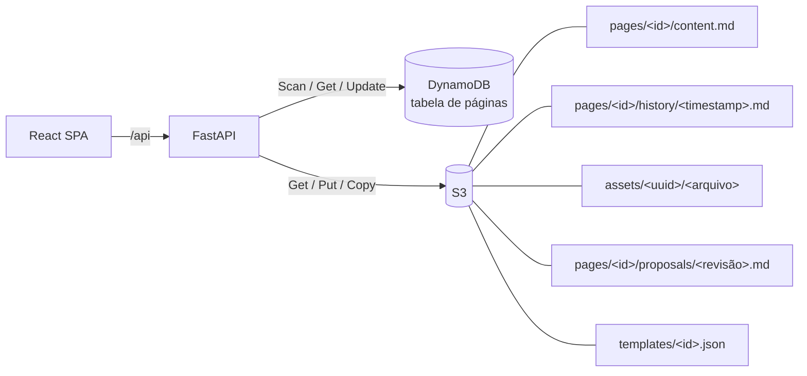

# Account Hub Docs

Template de documentação moderna e interativa para o **Account Hub**: leitura pública com busca, árvore de navegação, sumário e diagramas Mermaid, e um **painel admin** para editar páginas em markdown, reorganizar a doctree com arrastar-e-soltar, importar `.md`, gerenciar mídia e restaurar versões.

| Camada | Stack |
| --- | --- |
| Frontend | React 18 · TypeScript 5 · Vite 6 · React Router 7 · SWR · Tailwind CSS 3 · shadcn/ui · Radix UI · lucide-react · ESLint 10 |
| Markdown | react-markdown + remark-gfm (tabelas, tasks, footnotes) · alertas `> [!NOTE]` · highlight.js · **Mermaid** · CodeMirror 6 no editor |
| Backend | Python 3.11 · FastAPI · Uvicorn · httpx · boto3 · PyJWT |
| Dados | **DynamoDB** (metadados/árvore) · **S3** (markdown, histórico de versões, mídia) |
| Infra | Docker multi-stage (um container serve API + bundle) · docker-compose com DynamoDB Local + SeaweedFS (S3) |

## Rodando com Docker

```bash
cp .env.example .env      # ajuste ADMIN_PASSWORD e JWT_SECRET
docker compose up --build
```

- Documentação: http://localhost:8000/docs
- Painel admin: http://localhost:8000/admin (usuário/senha do `.env`)
- Swagger da API: http://localhost:8000/api/docs
- S3 local (SeaweedFS): http://localhost:8333 · DynamoDB Local: http://localhost:8001

Na primeira subida a tabela e o bucket são criados e páginas de exemplo são carregadas (`AUTO_CREATE_RESOURCES` / `SEED_ON_STARTUP`).

## Desenvolvimento sem Docker

```bash
# backend (precisa de um DynamoDB/S3: AWS real, docker compose up -d dynamodb s3, ou moto_server)
cd backend
python -m venv .venv && .venv/Scripts/activate     # Linux/macOS: source .venv/bin/activate
pip install -r requirements-dev.txt
uvicorn app.main:app --reload                       # lê backend/.env

# frontend (outro terminal) — proxy de /api para :8000
cd frontend
npm install
npm run dev        # http://localhost:5173
```

Sem Docker, dá para simular a AWS com o moto: `pip install "moto[server]"`, `moto_server -p 5055` e
`DYNAMODB_ENDPOINT_URL=S3_ENDPOINT_URL=http://127.0.0.1:5055`.

### Qualidade

```bash
cd frontend && npm run lint && npm run typecheck && npm run build
cd backend  && ruff check app tests e2e_server.py && pytest
```

Tudo de uma vez, igual à CI (no Windows): `./scripts/check.ps1` — com `-E2E` inclui os testes de ponta a ponta e com `-Docker` recria o container do app se tudo passar. A CI (`.github/workflows/ci.yml`) roda backend, frontend, ponta a ponta e o build da imagem Docker a cada push e pull request.

Testes de ponta a ponta (Playwright): sobem sozinhos um backend com AWS simulada em memória (`backend/e2e_server.py`, com páginas de exemplo e usuários de teste) e um Vite apontando para ele, então não dependem do Docker nem do `.env`. Cobrem leitura, busca, redirecionamento, login, criação e publicação de página e o fluxo de revisão.

```bash
cd frontend
npx playwright install chromium   # só na primeira vez
npm run e2e        # ou npm run e2e:ui para ver o navegador
```

## Funcionalidades

Identidade visual com a paleta Itaú: laranja `#EC7000` (marca e ações, com texto marinho para contraste AA), azul-marinho `#003399` (superfícies e tema escuro) e amarelo `#FFC20E` de apoio. Tipografia Plus Jakarta Sans + JetBrains Mono.

**Leitura (`/docs`)**
- Home em bento grid com busca em destaque, seção principal em card marinho e "atualizadas recentemente"
- Header flutuante, sidebar com **filtro**, indicador animado da página ativa e **modo foco** (`F`)
- Página com hero (ícone, descrição, tempo de leitura, autor), **barra de progresso de leitura** e sumário cuja linha acompanha a indentação
- **Prévia de links internos** ao passar o mouse, lightbox de imagens, código em painel marinho
- Mermaid com o tema da marca e **explorador com zoom e arraste**
- **Command Center** (`Ctrl/⌘ K` ou `/`) com páginas, busca no conteúdo, ações e painel de preview
- Atalhos: `[` `]` página anterior/próxima, `T` tema, `?` lista de atalhos

**Studio (`/admin`)**
- Rail lateral, Command Center com ações (`N` nova página) e menu de conta com seletor de tema
- **Visão geral**: métricas animadas, **saúde do conteúdo** (score + checklist: descrições, páginas desatualizadas, rascunhos, ícones), atividade recente, páginas por seção e status/latência do DynamoDB e S3
- Workspace em **painéis redimensionáveis**: navegador (doctree com arrastar-e-soltar e filtro), editor e inspetor
- Editor CodeMirror com modos Escrever / Dividir / Ler, **scroll sincronizado** e **comandos `/`** (títulos, listas, alertas, código, tabela, imagem, modelos Mermaid)
- **Carregar `.md`** arrastando no editor (front matter preenche título/descrição/ícone) ou importando vários arquivos/URL
- Imagens: `/Imagem`, botão, colar ou arrastar → upload para o S3
- **Inspetor** (painel lateral; gaveta em telas menores): propriedades, estrutura (outline clicável + métricas do texto) e últimas versões
- **Histórico de versões**: linha do tempo por dia com número da versão, autor e **descrição da alteração**; diff com números de linha ("vs. anterior" ou "vs. atual"), visualização renderizada, copiar/baixar e restaurar (cria uma nova versão, nada é apagado)
- **Salvar com descrição** (como mensagem de commit) — gravada nos metadados do S3 junto da versão
- Mover para… (escolhendo o novo pai), duplicar página, desfazer/refazer na barra
- **Recuperação de rascunho**: alterações não salvas ficam no navegador e são oferecidas de volta
- Salvar com `Ctrl/⌘ S`, controle de concorrência otimista (409) e aviso ao sair
- Mídia em masonry com busca, lightbox, copiar markdown/URL e overlay de upload

**Referência de API (OpenAPI e AsyncAPI)**
- Páginas do tipo **OpenAPI** (3.x) ou **AsyncAPI** (2.x/3.x): importe o `.yaml`/`.json` ou crie a partir do modelo — o conteúdo é a própria especificação, editada com realce YAML/JSON e prévia ao vivo
- OpenAPI: índice de operações por tag, parâmetros, corpo e respostas com schemas navegáveis, exemplos gerados e **código pronto** (cURL, JavaScript, Python)
- **Ambientes**: cada `server` da especificação aparece com nome, URL copiável e descrição. Nomeie com `x-environment` e marque o padrão dos exemplos com `x-default: true`; o leitor escolhe o ambiente e os exemplos de código passam a usar aquela URL
- AsyncAPI: ambientes (servidores com `title`), canais, operações (publicar/assinar) e mensagens com payload e exemplos

**Especificação dentro de páginas markdown**

Num guia comum, incorpore trechos de uma página de especificação com um bloco de código (ou pelo comando `/` → “Referência OpenAPI”):

````markdown
```openapi
ref: /docs/referencia-api/api-rest
operations:            # "MÉTODO /caminho" ou operationId (opcional)
  - POST /accounts/{account_id}/roles
tags: [Contas]         # opcional
```

```asyncapi
ref: /docs/referencia-api/eventos
channels: [roleBindings]   # id ou endereço do canal (opcional)
```
````

Sem filtro, a referência inteira é exibida. O trecho acompanha a especificação; um `ref:` para página inexistente ou do tipo errado aparece no checklist de links quebrados. Também dá para colar uma especificação inteira dentro do bloco.

**Editor: rascunho local, letras de situação e links**
- Tudo que você edita é guardado sozinho **neste navegador** (`localStorage`: sobrevive a recarregar, fechar a aba e reabrir; fica só neste navegador). Ao sair da página nada se perde e não há pergunta; ao voltar, o texto reaparece, ainda marcado como não salvo. **Salvar** (local) é o passo que deixa pronto para enviar para revisão; **Descartar alterações…** (menu `⋯`) apaga o que foi guardado. Só se o navegador recusar a gravação (cheio ou bloqueado) o editor volta a perguntar antes de sair
- Situação de cada página, em letras como no VS Code, com o nome por extenso ao passar o mouse: **P** publicada (verde), **R** rascunho (âmbar), **M** modificada, alterações ainda não salvas (laranja), **S** salva neste navegador, pronta para enviar (azul) e **E** em revisão, há proposta aberta (violeta). A árvore do Studio combina a situação de publicação com o que está pendente (ex.: `P M`)
- **Ver alterações** (botão no topo ou menu `⋯`, e também dentro do formulário de revisão): diff do que está no editor, **antes de salvar e antes de enviar**. Alterna entre "desde a versão publicada" e, depois de um Salvar, "desde o último Salvar" (só o que veio depois). **Restaurar o último salvo…** volta o editor ao que foi salvo (ou à proposta carregada), sempre com confirmação; **Descartar tudo…** volta à versão publicada
- **Salvar e Enviar para revisão**: dois botões. Salvar só guarda neste navegador (o rascunho fica até ser enviado ou descartado); Enviar para revisão abre a tela **Alterações**, a mesma para uma ou várias páginas.
- **Alterações** (`/admin/changes`): lista as páginas com rascunho salvo neste navegador. Marque as que vão, escolha o tamanho da mudança de cada uma (correção, novidade ou mudança grande; a versão x.y.z resultante é calculada, não escolhida), escreva uma descrição e envie: cada página vira uma proposta. Cada linha tem "Ver alterações" (diff). Páginas em rascunho usam o botão *Pedir publicação* do editor.
- Referências de API: `/` > **Referência OpenAPI** ou **AsyncAPI** lista as especificações existentes e insere o bloco já com o `ref:`. Dentro de um bloco ```` ```openapi ````/```` ```asyncapi ````, `ref:` sugere as especificações do tipo certo e as listas `operations:`, `tags:` e `channels:` sugerem o que existe na especificação apontada
- Digite **`/`** no editor: o item **Link para página** mostra só as páginas da documentação e, conforme você digita (`/guia`), elas são filtradas por título ou endereço; Enter insere `[Título](/docs/endereço)`. As páginas também aparecem na lista geral de blocos, abaixo dos comandos. O antigo atalho "Link" virou **Link externo**

**Fluxo de revisão**
- Papéis: `admin` faz tudo; `editor` cria rascunhos e propõe mudanças. Usuários extras em `USERS=nome:senha:papel,...`
- **Toda mudança em página publicada passa por revisão, para qualquer papel (inclusive admin)**: o editor mostra "Enviar para revisão" no lugar de "Salvar" e a gravação direta é recusada pela API. A descrição ("o que mudou e por quê") é obrigatória
- Em página publicada, **Salvar** guarda o rascunho só neste navegador (não publica nem envia nada): dá para trocar de página e voltar, e ele reaparece sozinho. **Enviar para revisão** é o passo seguinte e só libera depois de salvar (o botão fica desativado enquanto houver alteração não salva); ele cria a proposta; o editor lembra em qual versão o rascunho foi feito, para a mesclagem comparar com ela
- Páginas novas nascem sempre como rascunho, que se edita direto; para publicar, "Pedir publicação" abre a proposta. Para voltar uma página publicada a rascunho, desligue o interruptor "Publicada" no editor e envie para revisão (a página só sai do ar quando a proposta for aplicada). Em página publicada, "Restaurar versão" carrega a versão no editor e segue pelo mesmo caminho
- Um admin comenta, **aprova** ou **pede alterações** e então **aplica** — a página ganha uma nova versão com o autor da proposta. Admin pode aprovar a própria proposta
- Diff da proposta contra a versão atual e prévia renderizada
- **Página mudou depois da proposta?** O servidor combina as duas mudanças, por linhas, como o `git merge`, a partir do texto da versão em que a proposta se baseou (guardado no histórico). Trechos que só um lado mudou entram sozinhos; trechos mudados dos dois lados viram conflitos que o revisor resolve um a um (manter a página, usar a proposta ou manter os dois). Mudanças em linhas vizinhas, sem uma linha intacta entre elas, contam como conflito. "Aplicar mesmo assim" (proposta inteira por cima) só aparece quando a versão-base não foi encontrada
- Propostas só de campos (título, slug, ícone, descrição, publicação) se aplicam sem esse passo, e os campos da proposta valem
- Badge de revisões abertas no rail e no painel. `REVIEW_SELF_APPROVAL=false` volta a exigir que outro admin aprove (padrão: `true`)
- Mover e excluir páginas continuam sendo ações diretas de admin (a revisão cobre conteúdo, título, slug, ícone, descrição e publicação)

**Versões x.y.z**
- Cada página tem uma versão no formato `x.y.z`, como as versões do GitHub. Páginas novas nascem em `0.1.0` (rascunho); cada salvamento direto de rascunho sobe o último número; a **primeira publicação vira `1.0.0`**
- Ao enviar uma mudança para revisão, o autor escolhe o tamanho: **Correção** (`x.y.Z`: texto, link, formatação), **Novidade** (`x.Y.0`: conteúdo novo sem quebrar o que existia) ou **Mudança grande** (`X.0.0`: reescrita ou mudança que quebra quem seguia a versão anterior). O formulário mostra a prévia (ex.: `1.0.0 → 1.1.0`)
- O número recomendado vem do tamanho escolhido, mas **qualquer parte do `x.y.z` pode ser trocada à mão**, tanto por quem envia a proposta quanto por quem a aplica (que tem a palavra final). A versão escolhida precisa ser maior que a atual (compara número a número: `1.10.0` > `1.9.0`); mudar o tamanho volta para a recomendada, e há um atalho "Usar a recomendada"
- Se a página avançou depois da proposta e a versão escolhida pelo autor deixou de ser maior que a atual, a tela de aplicar avisa e sugere a recomendada no lugar
- A versão nova é calculada **quando a proposta é aplicada**, sobre a versão que a página tem naquele momento (se outra mudança entrou antes, a conta já considera)
- Histórico, revisões, eventos e mensagens de mesclagem mostram `x.y.z`. Por baixo continua um número de revisão inteiro, que cuida de edições simultâneas e da mesclagem
- Páginas e propostas anteriores a isso ganham a versão equivalente: a revisão `n` vira `1.0.(n-1)`
- O histórico guarda os textos anteriores; uma mudança só de propriedades (ex.: a publicação) tem versão própria mas não aparece como entrada no histórico

**Modelos de página**
- Galeria ao criar página: em branco, guia passo a passo, runbook, ADR, notas de release, visão geral de serviço, FAQ, OpenAPI e AsyncAPI
- “Salvar como modelo” a partir de qualquer página (guardado no S3); `{{title}}`, `{{date}}` e `{{author}}` são preenchidos na criação

**Busca**
- Ignora acentos e maiúsculas ("autenticacao" encontra "Autenticação")
- Índice em memória montado com um único Scan e reaproveitado entre buscas; gravações da própria instância o atualizam na hora e as de outras instâncias aparecem em até `SEARCH_CACHE_TTL_SECONDS` (padrão 60)

**Endereços antigos continuam funcionando**
- Ao renomear o slug ou mover uma página, o endereço antigo (dela e de todas as subpáginas) passa a levar ao novo, mantendo a âncora `#seção`
- O redirecionamento aponta para a página, não para um endereço: mudanças seguidas não criam cadeias, e uma página excluída volta a dar 404. Consulta: `GET /api/redirects?path=...`

**Prévia ao compartilhar links**
- O HTML de `/docs/<caminho>` sai do servidor com título, descrição e tags Open Graph/Twitter da página, lidos por WhatsApp, Slack, Teams e LinkedIn (que não executam JavaScript)
- Rascunhos nunca aparecem, e com `PUBLIC_READ=false` a prévia é sempre genérica. Atrás de proxy, defina `PUBLIC_URL` para o `og:url` usar o endereço público

**Links e imagens quebrados**
- O checklist de qualidade verifica links internos (`/docs/...`) para páginas inexistentes ou em rascunho e imagens/arquivos (`/api/assets/...`) apagados do S3, com página e linha de cada ocorrência — e entram no score de saúde

## Modelo de armazenamento



Item do DynamoDB (chave `id`): `title`, `slug`, `parent_id`, `order`, `icon`, `description`, `published`,
`version`, `kind` (`doc` | `openapi` | `asyncapi`), `created_at`, `updated_at`, `updated_by` e `search_text` (texto puro para a busca).
Na mesma tabela ficam as propostas de revisão (`record = "review"`) e contadores (`record = "counter"`).
A URL de cada página é derivada dos slugs dos ancestrais (`/docs/guias/autenticacao`).

## Formato dos arquivos `.md` importados

```markdown
---
title: Webhooks
description: Como receber eventos do Account Hub
icon: Webhook          # nome de ícone lucide (veja frontend/src/lib/icons.ts)
slug: webhooks
published: true        # ou draft: true
---

# Webhooks
...
```

Sem front matter, o título vem do primeiro `# heading` ou do nome do arquivo.

## Produção (AWS)

1. Crie a tabela (chave de partição `id` do tipo String, on-demand) e o bucket — ou suba uma vez com `AUTO_CREATE_RESOURCES=true`.
2. Dê à role do container as permissões de [`deploy/iam-policy.json`](deploy/iam-policy.json).
3. Rode a imagem com `DYNAMODB_ENDPOINT_URL` e `S3_ENDPOINT_URL` **vazios**, `COOKIE_SECURE=true`, `APP_ENV=production`, `ADMIN_PASSWORD` e `JWT_SECRET` fortes e `SEED_ON_STARTUP=false`. Com `APP_ENV=production` o backend se recusa a subir com senha ou segredo padrão ou fracos (senhas com menos de 12 caracteres, `JWT_SECRET` com menos de 32).

```bash
docker build -t accounthub-docs .
docker run -p 8000:8000 --env-file .env.prod accounthub-docs
```

`PUBLIC_READ=false` exige login também para ler a documentação. Para publicar a partir de CI, faça
`POST /api/auth/login` e use o `token` retornado como `Authorization: Bearer` nas rotas `/api/admin/*`.

> A busca e a árvore usam `Scan` (com cache curto em memória), adequado para centenas/milhares de páginas.
> Para volumes maiores, troque a busca por OpenSearch e indexe via DynamoDB Streams.

## Estrutura

```
backend/
  app/
    main.py            # FastAPI, rotas e servidor do bundle (SPA fallback)
    storage.py         # DynamoDB + S3 (páginas, conteúdo, histórico, mídia)
    service.py         # árvore, CRUD, mover, busca, importação (httpx)
    auth.py            # JWT via cookie httpOnly ou Bearer; papéis admin/editor
    reviews.py         # propostas de revisão (comentar, aprovar, aplicar)
    library.py         # modelos de página
    specs.py           # detecção e metadados de OpenAPI/AsyncAPI
    links.py           # relatório de links e imagens quebrados
    routers/           # auth, public (leitura) e admin
    seed_content/      # páginas de exemplo
  tests/               # pytest + moto
frontend/
  src/
    components/ui/     # shadcn/ui (Radix)
    components/docs/   # árvore, busca, sumário
    components/admin/  # editor, doctree DnD, importação, histórico
    components/markdown/ # renderer, Mermaid, alertas
    pages/             # docs, login, admin
Dockerfile · docker-compose.yml · .env.example
```
