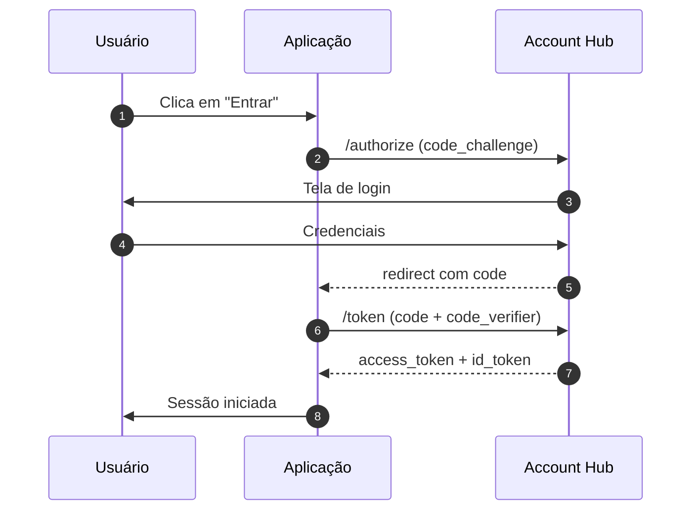

# Autenticação

O Account Hub implementa **OAuth 2.0 Authorization Code com PKCE**.



## Exemplo de troca de token

```ts
const response = await fetch("https://accounts.example.com/oauth/token", {
  method: "POST",
  headers: { "Content-Type": "application/x-www-form-urlencoded" },
  body: new URLSearchParams({
    grant_type: "authorization_code",
    code,
    code_verifier: verifier,
    redirect_uri: "https://app.example.com/callback",
  }),
});
const { access_token } = await response.json();
```

> [!CAUTION]
> Nunca armazene `client_secret` em aplicações que rodam no navegador.
