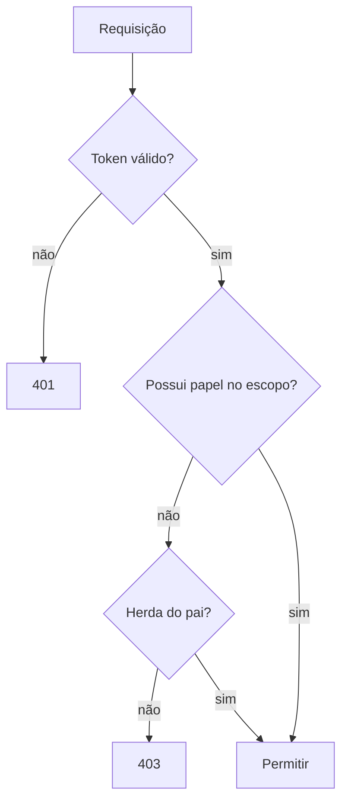

# Contas e permissões

As permissões são concedidas por **papéis** vinculados a uma conta dentro de um escopo (organização ou time).

## Papéis padrão

| Papel | Ler | Editar | Administrar |
| --- | :---: | :---: | :---: |
| `viewer` | ✅ | ❌ | ❌ |
| `editor` | ✅ | ✅ | ❌ |
| `owner` | ✅ | ✅ | ✅ |

## Avaliação de acesso



## Conceder um papel pela API

Use `grantRole` informando o papel e o escopo. A especificação abaixo vem direto da [referência da API](/docs/referencia-api/api-rest) — quando a API mudar, este trecho acompanha.

```openapi
ref: /docs/referencia-api/api-rest
operations:
  - POST /accounts/{account_id}/roles
  - GET /organizations/{organization_id}/members
```

Cada concessão publica um evento no Kafka, útil para sincronizar caches de autorização:

```asyncapi
ref: /docs/referencia-api/eventos
channels:
  - roleBindings
```

## Roadmap

- [x] Herança de organização para times
- [x] Papéis customizados
- [ ] Permissões temporárias (em breve)
