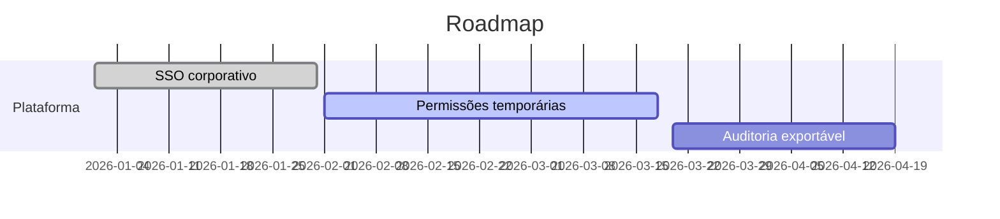
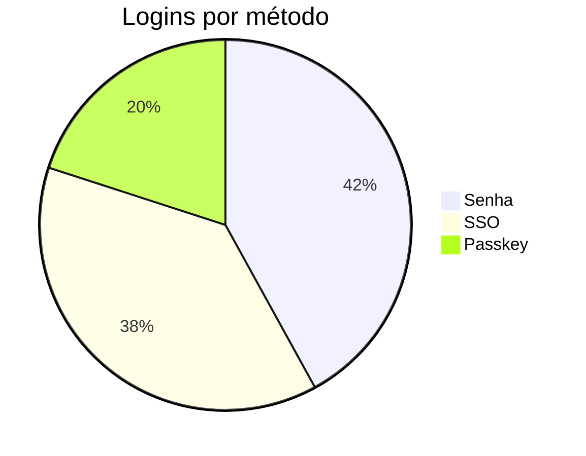

# Guia de escrita

Esta página demonstra tudo o que o renderizador suporta. Use-a como referência ao editar.

## Texto

Texto em **negrito**, *itálico*, ~~riscado~~, `código inline` e [links](https://example.com).

## Alertas

> [!NOTE]
> Informação útil que o leitor deve saber.

> [!TIP]
> Uma dica para fazer algo melhor.

> [!IMPORTANT]
> Informação essencial.

> [!WARNING]
> Requer atenção imediata.

> [!CAUTION]
> Consequências negativas de uma ação.

## Código

```python
from fastapi import FastAPI

app = FastAPI()


@app.get("/health")
def health() -> dict[str, str]:
    return {"status": "ok"}
```

## Mermaid

Qualquer bloco de código com a linguagem `mermaid` vira diagrama:





## Tabelas e listas

| Recurso | Suporte |
| --- | --- |
| Tabelas GFM | ✅ |
| Listas de tarefas | ✅ |
| Notas de rodapé | ✅ |

- [x] Item concluído
- [ ] Item pendente

Uma nota de rodapé[^1].

[^1]: Notas de rodapé aparecem no fim da página.

## Imagens

Envie imagens pelo editor (botão **Imagem**, colando ou arrastando o arquivo) — elas são salvas no S3 e servidas por `/api/assets/...`.
