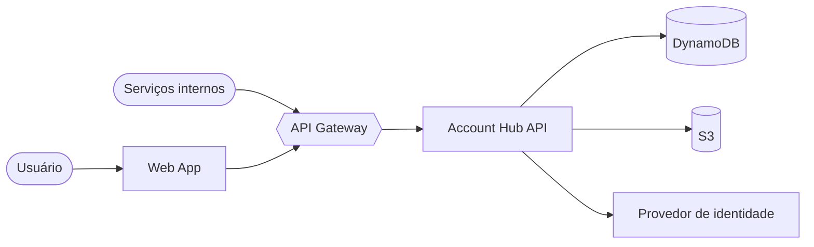

# Bem-vindo ao Account Hub

O **Account Hub** centraliza contas, perfis, organizações e permissões em um único lugar. Esta documentação reúne tudo o que você precisa para integrar, operar e evoluir a plataforma.

> [!TIP]
> Pressione Ctrl + K (ou ⌘ + K) em qualquer página para abrir a busca.

## O que você encontra aqui

| Seção | Para quem | Conteúdo |
| --- | --- | --- |
| Primeiros passos | Todos | Instalação local e configuração |
| Arquitetura | Engenharia | Componentes, fluxos e decisões |
| Guias | Times de produto | Autenticação, contas e permissões |
| Referência da API | Integradores | Endpoints, payloads e erros |

## Visão geral

## Principais recursos

- **Contas unificadas** — um único perfil para todos os produtos.
- **Organizações e times** — hierarquia flexível com herança de permissões.
- **RBAC granular** — papéis e políticas por recurso.
- **Auditoria** — todas as mudanças ficam registradas.

> [!NOTE]
> Esta é uma documentação de exemplo gerada pelo template. Edite ou apague as páginas pelo painel em `/admin`.
