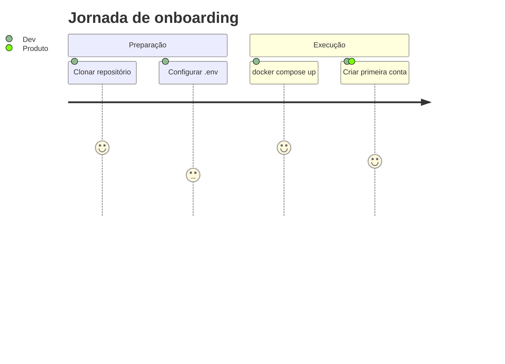

# Primeiros passos

Siga estes passos para ter um ambiente funcional:

1. [Instale](/docs/primeiros-passos/instalacao) as dependências e suba os serviços.
2. [Configure](/docs/primeiros-passos/configuracao) as variáveis de ambiente.
3. Explore a [referência da API](/docs/referencia-api).

